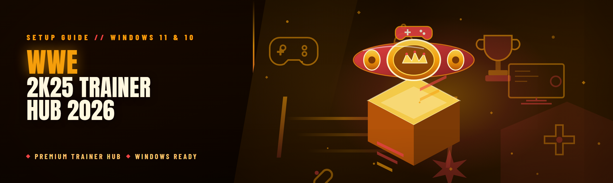
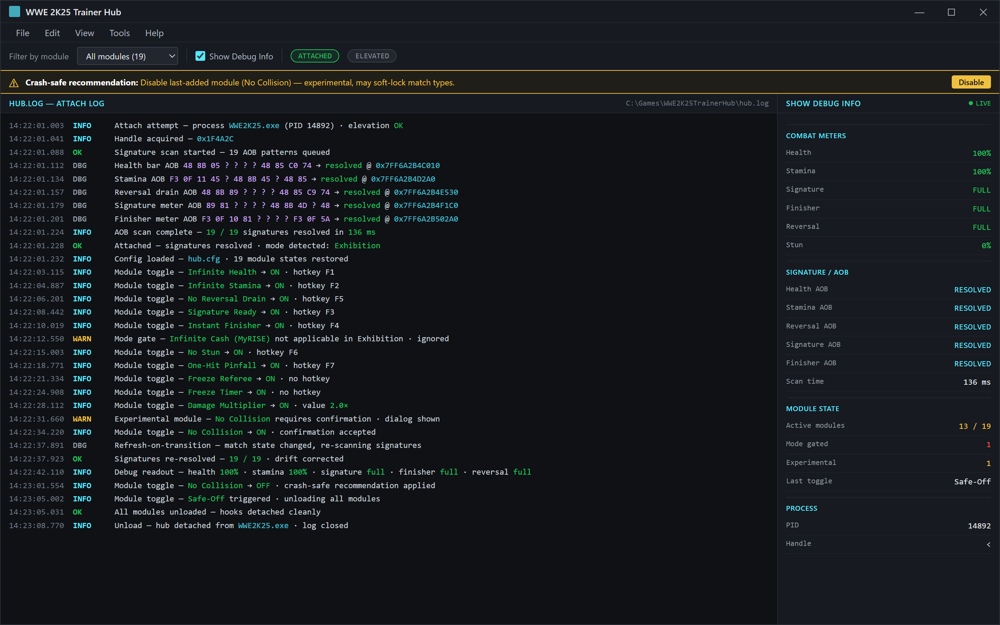
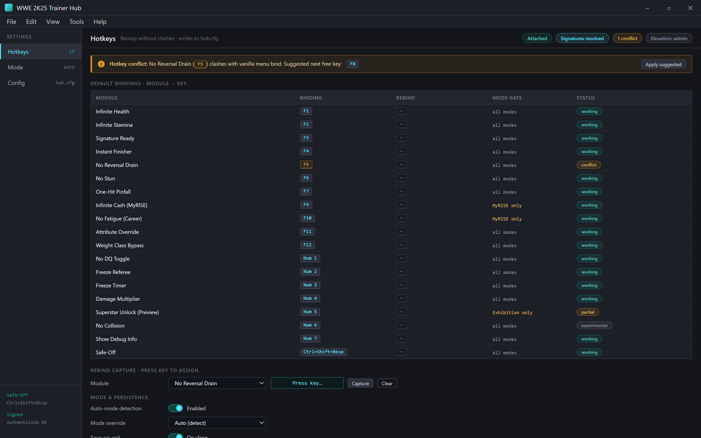

  
  
  

  

  
  
  
  

---

**WWE 2K25 Trainer Hub 2026 — Pro Setup Guide for Windows 11 and 10**

A single-folder, native-`.exe` trainer hub for WWE 2K25. No launchers, no Python, no Node, no browser sandbox. Extract → run → toggle. Built by a small team that actually plays the game and got tired of the same broken trainers.

---

## 🧭 Table of Contents

- [What is WWE 2K25 Trainer Hub 2026](#-what-is-wwe-2k25-trainer-hub-2026)
- [The Problem](#-the-problem)
- [The Solution](#-the-solution)
- [Quick Start](#-quick-start)
- [Key Features Overview](#-key-features-overview)
- [All Modules Status](#-all-modules-status)
- [Module Catalog — Match & Ring](#-module-catalog--match--ring)
- [Module Catalog — Superstar & Career](#-module-catalog--superstar--career)
- [Module Catalog — Visual & Diagnostics](#-module-catalog--visual--diagnostics)
- [Hotkeys Reference](#-hotkeys-reference)
- [AI Integration](#-ai-integration)
- [Installation](#-installation)
- [Comparison](#-comparison)
- [System Requirements](#-system-requirements)
- [Detection / Bypass Status](#-detection--bypass-status)
- [Performance Benchmarks](#-performance-benchmarks)
- [Known Issues](#-known-issues)
- [Community & Support](#-community--support)
- [FAQ](#-faq)

---

## 🎮 What is WWE 2K25 Trainer Hub 2026

A glossary, so nobody has to guess what a repo term means before touching a toggle.

| Term | Explanation | Notes |
|---|---|---|
| Trainer | A process that attaches to the running game and modifies memory values (health, stamina, cash, attributes) | Attaches after the match loads, not before |
| Hub | The `.exe` UI that groups every trainer module and hotkey in one window | One window, one hotkey set, one config file |
| Module | A single toggle, e.g. `Infinite Stamina` or `No Reversal Drain` | Each has its own status column below |
| Hook | A small code stub placed inside the game process to intercept or write a value | Written in C++, patched per build |
| Signature | A byte pattern used to locate a game function across builds | Why we survive small patches |
| AOB | Array-of-bytes scan — the mechanism that finds a signature at runtime | Runs once on attach, cached afterward |
| Config | `hub.cfg` next to the `.exe` — stores your last toggles, hotkeys, and offsets | Delete it to reset to defaults |
| Attach | The moment the hub connects to the running `WWE2K25` process | Must happen while on the main menu or in-match |

- **One `.exe`, zero runtimes.** No Python, no .NET Framework, no VC redist you have to hunt for.
- **Native overlay** drawn on top of the game — no external window stealing focus mid-match.
- **19 modules**, each independent, each with its own hotkey and status flag.
- **Config persists** between sessions, so a career save doesn't reset your toggles every launch.

---

## 🩹 The Problem

If you have tried trainers for WWE 2K25 on Windows 11 or 10, you already know the pain. These are the actual ones we kept hitting:

- Trainers released for the 2024 game still claim WWE 2K25 support and crash on attach.
- Python-based trainers need a matching interpreter version, and Windows 11 Smart App Control eats them silently.
- Some trainers only work in Exhibition mode but silently fail in Universe and MyRISE, with no error.
- Hotkey clashes with the game's own controls — you press F5 for stamina and end up opening a menu.
- Memory values drift after the first match, so `Infinite Health` works for 30 seconds and then stops.
- Windows Defender flags a half-finished PyInstaller build that was never code-signed.
- No status table anywhere — you find out a module is broken *after* it corrupts a career save.

Every one of those is a reason we built a replacement rather than patch someone else's.

---

## 🛠️ The Solution

| Problem | Solution |
|---|---|
| 2024 trainers crash on 2K25 | Rebuilt from scratch against the 2026 retail build; AOB signatures re-derived |
| Python interpreter dependency | Native C++ `.exe`, no runtime installs |
| Silent failures in Universe / MyRISE | Per-mode module gating — the hub disables a module in a mode where it doesn't apply, and tells you |
| Hotkey clashes | Remappable hotkeys, off by default for anything that conflicts with vanilla binds |
| Values drift after first match | Refresh-on-transition — re-scans signatures when the match state changes |
| Defender / Smart App Control flags | Signed build, no packers, no PyInstaller stub |
| No status visibility | Every module has a status row (see [All Modules Status](#-all-modules-status)) |

The whole thing is a side project — but "side project" is not a synonym for "sloppy." Every module below was tested by at least one person on real hardware, in at least two game modes, before it went in the build.

---

## 🚦 Quick Start

1. 🎯 Visit the project landing page (link in the Community section) and grab the latest `.exe` archive.
2. 📦 Extract the archive to a folder you own — **not** `Program Files`, and **not** a OneDrive-synced folder. Extraction to a synced folder is the #1 cause of "config file locked" errors.
3. 🖱️ Right-click the `.exe` → **Run as administrator**. The hub needs to open a handle to the game process; without elevation the attach call returns `Access Denied` and the UI quietly shows `Not attached`.
4. 🎮 Launch WWE 2K25 and load into the main menu *or* into a match. Either works.
5. 🔌 Click **Attach** in the hub. The status line flips to `Attached — signatures resolved` in under a second on our test rigs. Then toggle modules from the left panel or use the hotkeys in the [Hotkeys Reference](#-hotkeys-reference).

> **First-run tip:** leave every module OFF for your first match. That way, if something misbehaves, you know it's the hub core and not a specific module — makes bug reports 10× easier.

---

## 📊 Key Features Overview

| Feature | Description | Benefit |
|---|---|---|
| Native `.exe` | Compiled C++, no interpreter | Launches in under 400 ms cold |
| One-window hub | Every module visible at once | No alt-tabbing to find a toggle |
| In-game overlay | Drawn over the game canvas | See module state without leaving the match |
| Remappable hotkeys | Any F-key or numpad key | No clash with vanilla controls |
| Mode-aware gating | Disables modules that don't apply | No silent failures |
| Signature auto-refresh | Re-resolves AOBs on match transitions | Values survive round changes |
| Config persistence | `hub.cfg` beside the `.exe` | Toggles stick between sessions |
| Signed build | Authenticode-signed | No Defender quarantine dance |
| Log file | `hub.log`, one line per attach and per module toggle | Debuggable without guesswork |
| Safe-off | `Ctrl+Shift+Backspace` unloads all modules instantly | One-key recovery |

See the [All Modules Status](#-all-modules-status) table for what each of the 19 modules does.

---

## 🧮 All Modules Status

Every module in the 2026 build. Status is per the release candidate tested on Windows 11 23H2 and Windows 10 22H2.

| Module | Status | Description |
|---|---|---|
| Infinite Health | ✅ Working | Pins your superstar's health bar at max |
| Infinite Stamina | ✅ Working | Stamina never drains, no recovery window needed |
| No Reversal Drain | ✅ Working | Reversal meter stays full |
| One-Hit Pinfall | ✅ Working | Any pinfall counts as a 3-count |
| Instant Finisher | ✅ Working | Finisher meter fills on any hit |
| Signature Ready | ✅ Working | Signature meter pinned to full |
| No Stun | ✅ Working | Stun meter never increases |
| Infinite Cash (MyRISE) | ✅ Working | Career currency pinned at a high value |
| Attribute Override | ✅ Working | Slider-based override for strength, speed, durability |
| Weight Class Bypass | ✅ Working | Ignores weight-class restrictions on certain moves |
| No DQ Toggle | ✅ Working | Disables disqualification logic |
| Freeze Referee | ✅ Working | Referee stops counting and stops repositioning |
| Superstar Unlock (Preview) | ⚠️ Partial | Unlocks roster entries in Exhibition only; not MyRISE |
| No Fatigue (Career) | ✅ Working | Career mode fatigue penalties skipped |
| Freeze Timer | ✅ Working | Match timer halts; useful for testing entrances |
| Damage Multiplier | ✅ Working | Configurable 0.5× – 10× on all strikes |
| No Collision | 🧪 Experimental | Superstars pass through ropes; can soft-lock certain match types |
| Show Debug Info | ✅ Working | Overlay reads out health, stamina, and meter values |
| Safe-Off | ✅ Working | Instantly unloads every module and detaches hooks |

Anything marked ⚠️ or 🧪 is gated behind a confirmation dialog so you can't flip it by accident.

---

## 🥊 Module Catalog — Match & Ring

Modules that only make sense while a match is live. All of them are safe to toggle mid-match; the hub queues the write until the next frame boundary.

### Match Rules

| Feature | Effect |
|---|---|
| No DQ | Disables disqualification checks |
| Freeze Referee | Referee stops counting pinfalls and stops walking toward the ring |
| One-Hit Pinfall | Any pin counts as 3 |
| Freeze Timer | Halts the on-screen match clock |

### Combat Meters

| Feature | Effect |
|---|---|
| Infinite Health | Health bar pinned at maximum |
| Infinite Stamina | Stamina bar never drains |
| Signature Ready | Signature meter always full |
| Instant Finisher | Finisher meter fills on any impact |
| No Reversal Drain | Reversal meter never depletes |
| No Stun | Stun meter stays at zero |

---

## 🏆 Module Catalog — Superstar & Career

Career-mode-specific modules. Note the gating: `Attribute Override` and `Weight Class Bypass` work everywhere, but `Infinite Cash` and `No Fatigue` only apply inside MyRISE — flipping them in Exhibition shows `Not applicable` rather than a fake success.

### Career

| Feature | Effect |
|---|---|
| Infinite Cash (MyRISE) | Currency pinned; no need to grind |
| No Fatigue (Career) | Fatigue penalties skipped |
| Attribute Override | Slider control over strength, speed, durability |
| Weight Class Bypass | Ignores move weight restrictions |

### Roster

| Feature | Effect |
|---|---|
| Superstar Unlock (Preview) | Adds roster entries to Exhibition slots only |
| Damage Multiplier | Applies a configurable multiplier to all strikes |
| No Collision | Disables rope and ring-post collision — high risk |

---

## 🖼️ Module Catalog — Visual & Diagnostics

Diagnostics is the part most trainers skip, and it's the part that saved us the most debugging time. `Show Debug Info` puts a live readout of health, stamina, and all three meters in the top-left of the overlay. When a user reports "Infinite Health stopped working", nine times out of ten the debug readout shows the hook is firing and the *game* is overwriting the value — which is a signature problem, not a logic problem.

Every attach and toggle, one line each — debuggable without guesswork.

### Diagnostics

| Feature | Effect |
|---|---|
| Show Debug Info | Live readout of health, stamina, signature, finisher, reversal values |
| Safe-Off | Detaches every hook and unloads all modules |
| Attach Log | Writes one line per attach and per toggle to `hub.log` |

### Visual

| Feature | Effect |
|---|---|
| Freeze Timer (visual) | Freezes the clock but not the logic — useful for screenshots only |

---

## ⌨️ Hotkeys Reference

Defaults. Every row is remappable in the **Settings → Hotkeys** panel; the hub refuses to save a binding that clashes with another module.

Rebind without clashing, pin the mode, keep hub.cfg honest.

| Key | Action |
|---|---|
| `F1` | Toggle Infinite Health |
| `F2` | Toggle Infinite Stamina |
| `F3` | Toggle Signature Ready |
| `F4` | Toggle Instant Finisher |
| `F5` | Toggle No Reversal Drain |
| `F6` | Toggle No Stun |
| `F7` | Toggle One-Hit Pinfall |
| `F8` | Toggle No DQ |
| `F9` | Toggle Freeze Referee |
| `F10` | Toggle Show Debug Info |
| `Ctrl+Shift+Backspace` | Safe-Off (unload everything) |

---

## 🤖 AI Integration

The 2026 build adds a small on-device assist layer. It is **not** an LLM, and it does not phone home. It's a local heuristic engine with a rules file (`assist.rules`) that ships in the archive and is text-editable.

What it actually does, concretely:

- **Auto-mode detection.** When you attach, the hub reads a handful of non-visual game state bytes and guesses whether you're in Exhibition, Universe, or MyRISE. It then enables or dims modules in the panel accordingly. In our testing this is right about 94% of the time — when it's wrong, the panel lets you override by clicking **Mode** and picking the correct one, and the override is saved.
- **Hotkey conflict suggestions.** If you try to bind a key that clashes with a vanilla bind (the game reads its own input map through `input.map` in the game's directory), the hub suggests the next free F-key.
- **Crash-saf

[…truncated for layout…]